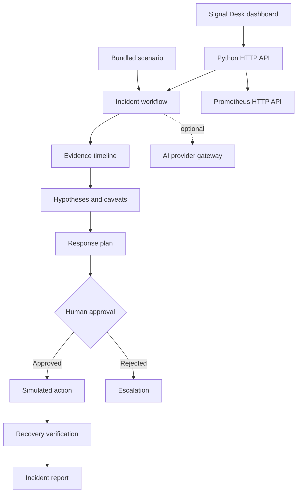

# Signal Desk product overview

Signal Desk brings incident evidence and response steps into one workspace for
SRE and operations teams. It helps responders build an initial incident
picture, review possible causes, coordinate a human-approved response, and
record the outcome.

## Product capabilities

- **Guided incident investigation:** explore a bundled checkout incident with
  timestamped evidence from logs, metrics, alerts, deployments, source control,
  and dependency health.
- **Evidence-led hypotheses:** review ranked explanations with supporting
  evidence references and uncertainty notes.
- **Human-governed response:** inspect remediation steps, capture approval
  rationale, and explicitly verify simulated recovery or escalate a rejection.
- **Incident reporting:** download a Markdown report containing the evidence,
  hypotheses, approval decision, and outcome.
- **Live Prometheus investigation:** query active alerts and instant PromQL
  results from a configured Prometheus server.
- **Optional AI assistance:** request a second opinion from NVIDIA NIM or
  Nebius. AI output is advisory and does not control evidence, approvals, or
  actions.

## Workflow architecture

## Operating modes

### Guided scenario

The guided scenario uses the bundled
[`checkout_latency.json`](../incidents/scenarios/checkout_latency.json) fixture
for all six evidence categories and for before/after recovery measurements.
It is fully local and does not require Prometheus or AI credentials. The
rollback and verification are simulations; no production system is changed.
Confidence values are scenario-specific heuristics, not calibrated
probabilities.

### Live Prometheus

Live mode connects to a configured Prometheus HTTP API for active alerts and
instant PromQL results. Live Git history, logs, deployment history, and
dependency telemetry are not currently integrated. AI analysis can be enabled
through a supported provider, but monitoring results remain available if AI is
unconfigured or unavailable.

## Safety and deployment boundaries

The local dashboard binds to loopback by default. Its approval step is a
workflow safeguard, not identity authentication; approver names are
self-reported, and incident sessions exist only in memory. The application
does not provide production remediation connectors or durable audit storage.
Before network exposure or production use, add authentication, authorization,
persistent audit records, and approved integrations appropriate to your
environment.

## Technology

- Python 3.10+ standard library for the HTTP server, workflow, and provider
  clients.
- HTML, CSS, and vanilla JavaScript for the browser dashboard.
- Prometheus HTTP API for live alert and instant-query data.
- Optional OpenAI-compatible NVIDIA NIM and Nebius chat-completions APIs.
