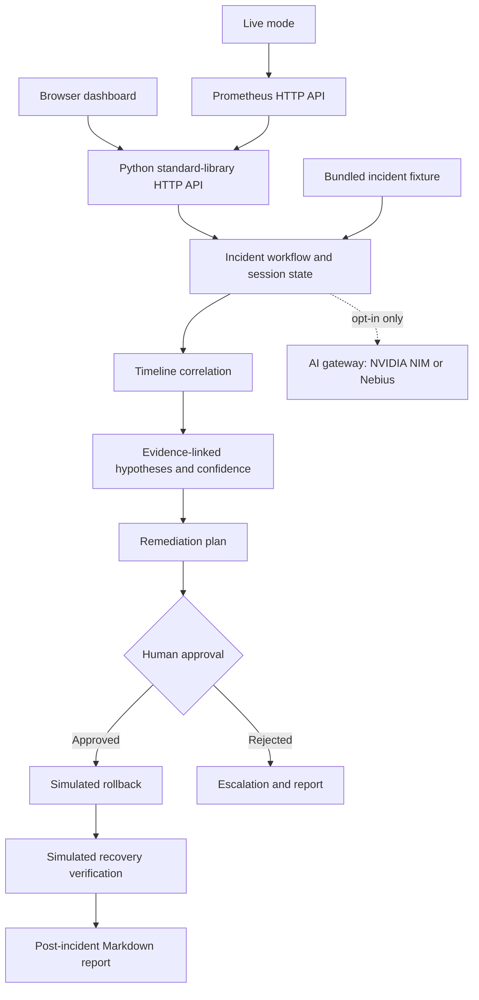

# Round 2 Prototype Submission — Signal Desk

## Submission summary

- **Challenge track:** AI Agent for Production Incident Investigation & Recovery
- **Prototype:** Signal Desk — Eclipse incident agent
- **Stage:** Working local prototype; simulated incident recovery
- **Team:** [Enter team name]
- **Team members:** [Enter member names]
- **Source repository:** [Enter submission repository URL]
- **Demo URL/video:** [Enter hosted demo URL or video link, if required]

Signal Desk demonstrates an evidence-led SRE incident workflow. It correlates
timestamped incident evidence, explains competing root-cause hypotheses,
proposes a guarded remediation, requires human approval for a high-impact
action, verifies the simulated recovery or escalates a rejection, and produces
a post-incident report.

## What is implemented

- Browser dashboard and local Python HTTP API.
- A reproducible checkout-latency scenario with six evidence categories:
  application logs, Prometheus-style metrics, deployment history, Git commit,
  alert, and service dependency health.
- Chronologically ordered evidence timeline and source attribution.
- Competing root-cause hypotheses with evidence references, explanatory
  rationale, explicit caveats, and heuristic confidence estimates.
- A remediation plan with a high-impact approval gate and recorded approver
  rationale.
- Simulated rollback, recovery checks, explicit escalation on rejection, and a
  downloadable Markdown post-incident report.
- Optional AI second opinion. It is advisory and cannot change evidence,
  confidence, the plan, approval state, or execute actions.
- Separate live Prometheus alert and instant PromQL query mode.

## System architecture

**Demo data path:** the bundled JSON fixture supplies all six evidence
categories and the simulated before/after measurements. The local workflow
sorts the fixture events by timestamp and applies transparent, scenario-specific
rules to construct the hypotheses and remediation plan.

**Live data path:** live mode queries the configured Prometheus HTTP API for
alerts and instant PromQL results. It does not yet ingest live logs, Git
history, deployment history, or service dependency telemetry.

## Agent workflow

1. **Input:** select the demo incident and optionally enter incident context.
2. **Understand:** load the evidence fixture, group evidence by source, sort
   events chronologically, and calculate metric changes against baseline.
3. **Plan:** rank evidence-backed hypotheses and construct read-only checks and
   a rollback option. The estimate is a rule-based demo score, not a
   statistically calibrated probability.
4. **Use tools:** the demo reads its scenario fixture and uses the application's
   investigation, approval, verification, and report APIs. Live mode uses the
   Prometheus HTTP API. The optional AI gateway can provide a second opinion.
5. **Act:** the demo records a simulated rollback only after explicit approval
   and an approval rationale. It has no production deployment connector.
6. **Verify or escalate:** verify simulated error rate, latency, alert state,
   and restored version. A rejected action is escalated to the incident
   commander.
7. **Report:** generate a Markdown incident report after verification or
   escalation.

## AI and safety

- Optional AI providers: NVIDIA NIM or Nebius Token Factory, using the
  OpenAI-compatible chat completions interface.
- Demo AI context is sent only after the user checks the AI opt-in. Live mode
  attempts the configured AI analysis as part of an investigation.
- Evidence correlation, confidence, approval decisions, and demo actions are
  deterministic application behavior—not model claims.
- The AI system instruction asks for evidence/hypothesis separation and
  read-only checks. AI output never triggers an action.
- High-impact demo action requires an explicit approval request with
  approver, rationale, and UI confirmation.
- **Prototype boundary:** this is not production-authorized automation.
  Approver names are self-reported, sessions are in-memory, the demo's
  observations are fixtures, and the demo rollback is simulated.

## Technologies and tools

- Python 3.10+ standard library: `http.server`, `urllib`, `asyncio`, JSON,
  threading, and `unittest`.
- HTML, CSS, and vanilla JavaScript dashboard.
- Prometheus HTTP API for live alerts and instant PromQL query mode.
- NVIDIA NIM / Nebius Token Factory provider gateway for optional AI analysis.
- No third-party Python packages or package installation required.

## Expected impact

The prototype is designed to reduce the time an on-call engineer spends
assembling a first incident picture by bringing alert, metric, log, deployment,
commit, and dependency context into one chronological view. Evidence links and
uncertainty notes are intended to make initial hypotheses easier to review.
Approval gates and recovery checks demonstrate a safer path from analysis to
action than an unreviewed, text-only recommendation.

These are expected benefits, not measured production outcomes. The bundled
scenario reports a simulated change from 0.4% to 18.4% errors and from 240 ms
to 2.42 s p95 latency, followed by simulated recovery to 0.6% and 0.29 s.
This fixture demonstrates the workflow; it is not an impact benchmark.

## Validation performed

- `py -m unittest discover -v` — 11 tests passed, including workflow API,
  approval gating, recovery verification, escalation, report retrieval, and
  mocked AI behavior.
- `node --check frontend\app.js` — passed.
- Python `compileall` — passed.
- Browser smoke test — completed a demo investigation, approval, and simulated
  recovery verification.

No live Prometheus server or external AI-provider request was validated as part
of this test run.

## Known limitations and next steps

1. Replace fixture sources with authorized read-only adapters for the
   participant's chosen logs, Git, deployment, alert, metrics, and service
   dependency systems.
2. Derive confidence from validated evidence features and evaluate it against
   labeled incidents; current scores are demonstration heuristics.
3. Use authenticated identities, durable audit events, persistent incident
   sessions, and role-based approval before any production deployment.
4. Add live recovery probes and explicit failure/rollback paths before
   integrating a real remediation system.
5. Add a hosted, access-controlled demo or record a demo video if required by
   the submission portal.

## Final submission checklist

- [ ] Replace team, member, repository, and demo placeholders above.
- [ ] Confirm the portal's required file formats, links, and deadline.
- [ ] Upload the source repository or attach the required archive.
- [ ] Add a demo video or hosted demo link if requested.
- [ ] Prepare any requested slide deck from this architecture and workflow.
- [ ] Confirm the shortlisted-team participation fee and payment status through
  the official Unstop process; this repository cannot pay or verify the fee.
